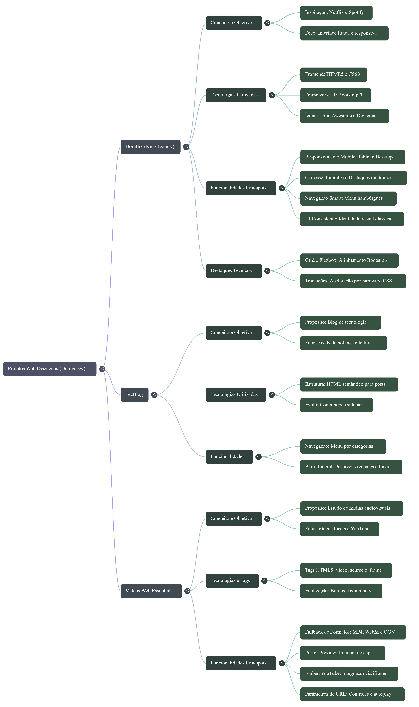

<h2 id="sobre-o-projeto">1. N8N Workflow Essentials - Automação com IA 🤖⚙️</h2>


[](https://github.com/Domisnnet/N8n-Workflow-Essentials/blob/main/LICENSE)



Bem-vindo ao **N8N Workflow Essentials**! Uma coleção de automações low-code que conecta seus projetos Web Essentials (TecBlog, Videos, Domflix, Responsive) com Inteligência Artificial. Inspirado na trilha **Santander - Automação com N8N** da DIO, este projeto transforma commits do GitHub em documentação visual automática via NotebookLM e Gemini.

---

<h2>📚 Tabela de Conteúdo</h2>

| 🤖 O Projeto | 🛠 Técnico | 🤝 Comunidade |
| :---: | :---: | :---: |
| [](#sobre-o-projeto) | [](#destaques-tecnicos) | [](#codigo-fonte) |
| [](#tecnologias-utilizadas) | [](#instalacao) | [](#créditos) |
| [](#como-acessar) | [](#como-contribuir) | [](#licenca) |
| [](#funcionalidades) | [](#faq) | [](#perfil-do-github) |

---

<h2 id="tecnologias-utilizadas">2. ⚙ Tecnologias Utilizadas</h2>

| Camada | Tecnologias | Descrição |
| :--- | :--- | :--- |
| **Automação** |  | Orquestração de workflows low-code rodando em localhost:5678 |
| **IA Generativa** |   | Análise de código e geração de mapa mental, podcast e infográfico |
| **API** |  | Coleta de commits, descrição e linguagens dos repos Web Essentials |
| **Geração Visual** |  | Criação do blueprint isométrico: Web Essentials - A Arquitetura dos Fundamentos |

---

<h2 id="como-acessar">3. 🚀 Como Acessar</h2>

Este projeto roda localmente. Para testar:

<h3>Para Rodar N8N localmente</h3>

<h4>No Terminal rode:</h4>

```bash
npx n8n start
```

```bash
Acesse http://localhost:5678
```

Importe o workflow `workflows/web-essentials.json`

<div align="left">
  <a href="https://n8n.io/" target="_blank">
    
  </a>
</div>

---

<h2 id="funcionalidades">4. 🧩 Funcionalidades Principais</h2>

| Funcionalidade | Descrição |
| :--- | :--- |
| 📥 **GitHub Trigger** | Monitora novos commits nos repos TecBlog, Videos, Domflix e Responsive via API |
| 🧠 **Prompt Engineering** | Melhora automaticamente o prompt antes de enviar para Gemini/NotebookLM |
| 🗺️ **Geração Automática** | Cria Mapa Mental, Guia de Estudos e Infográfico estilo blueprint isométrico |
| 🔗 **Integração** | Conecta NotebookLM -> Google Docs / Notion -> Telegram/WhatsApp |
| 💾 **Versionamento** | Salva workflows em JSON para reuso e portfólio (N8n-Workflow-Essentials) |

---

<h2 id="destaques-tecnicos">5. 💻 Destaques Técnicos</h2>

<h3>📐 Arquitetura do Workflow</h3>

> Uso do padrão `Manual Trigger -> Set -> HTTP Request - GitHub API -> Code Node -> AI Node -> HTTP` para garantir que a automação funcione offline e online.

<h3>🔄 NotebookLM + N8N</h3>
Implementação do conceito RAG (Retrieval-Augmented Generation): o N8N alimenta o NotebookLM com 3 fontes (GitHub) e o NotebookLM gera a documentação visual "Web Essentials: A Arquitetura dos Fundamentos - Uma dissecação técnica de UI, Semântica e Multimídia por DomisDev" com cubos neon HTML5 (verde), CSS3 (azul) e MULTIMEDIA API (vermelho).

---

<h2 id="instalacao">6. 🚀 Instalação Local</h2>

<h4>Clonar o repositório:</h4>

```bash
git clone https://github.com/Domisnnet/N8n-Workflow-Essentials.git
```
```bash
cd N8n-Workflow-Essentials
```

<h4>Rodar N8N:</h4>

```bash
npx n8n start
```

<h4>Ou docker:</h4>

```bash
docker run -it --rm --name n8n -p 5678:5678 -v ~/.n8n:/home/node/.n8n n8nio/n8n
```

> Importar workflow
>
> No UI: Workflows -> Import from File -> workflows/web-essentials-notebooklm.json
>
> Configurar credenciais
> Crie credencial Google Gemini API e GitHub (opcional)

---

<h2 id="como-contribuir">7. 🤝 Como Contribuir</h2>

| Fase | Ação | Comando |
| :--- | :--- | :--- |
| **01** | **Fork** | Faça Fork do repo |
| **02** | **Branch** | `git checkout -b feature/NovoWorkflow` |
| **03** | **Commit** | `git commit -m 'feat: workflow github-para-notion'` |
| **04** | **Push** | `git push origin feature/NovoWorkflow` |
| **05** | **PR** | Abra um Pull Request |

---

<h2 id="faq">8. 🧠 Perguntas Frequentes</h2>

<details>
<summary><strong>Preciso criar repo específico para rodar local? ❓</strong></summary>
<p>💻 <strong>Resposta:</strong> Não. O N8N salva tudo em ~/.n8n localmente. O repo N8n-Workflow-Essentials serve para versionar seus JSONs, documentar e entregar como projeto na DIO. Pode ser privado. Nunca commite credenciais ou .env com chaves.</p>
</details>

<details>
<summary><strong>Posso usar IA no N8N? ❓</strong></summary>
<p>🤖 <strong>Resposta:</strong> Sim! Este projeto é a prova. Usamos Gemini/Google AI + NotebookLM dentro do workflow para transformar código em infográfico, podcast e guia de estudos automaticamente.</p>
</details>

<details>
<summary><strong>Como gerar o infográfico surreal? ❓</strong></summary>
<p>🎨 <strong>Resposta:</strong> O nó Code gera o prompt: "Isometric blueprint technical illustration, dark background with grid, 3 glowing cubes HTML5 SEMANTICS neon green, CSS3 LAYOUT neon blue, MULTIMEDIA API neon red...". Use esse prompt em Stability AI, DALL-E ou Leonardo.AI.</p>
</details>

---

<h2 id="codigo-fonte">9. 💻 Código Fonte</h2>

[](https://github.com/Domisnnet/N8n-Workflow-Essentials)

---

<h2 id="créditos">10. 📝 Créditos</h2>

| Atribuição | Responsável |
| :--- | :--- |
| **Dev & Automação** | **DomisDev** |
| **Inspiração** | **DIO - Santander Automação com N8N & NotebookLM** |
| **IA** | **Google Gemini & NotebookLM** |

---

<h2 id="licenca">11. 📄 Licença</h2>

[](https://github.com/Domisnnet/N8n-Workflow-Essentials/blob/main/LICENSE)

---

<h2 id="perfil-do-github">12. 👨💻 Perfil</h2>

<a href="https://github.com/Domisnnet">
  
</a>

&nbsp;
<p align="center">
  <a href="#sobre-o-projeto">
    
  </a>
</p>

