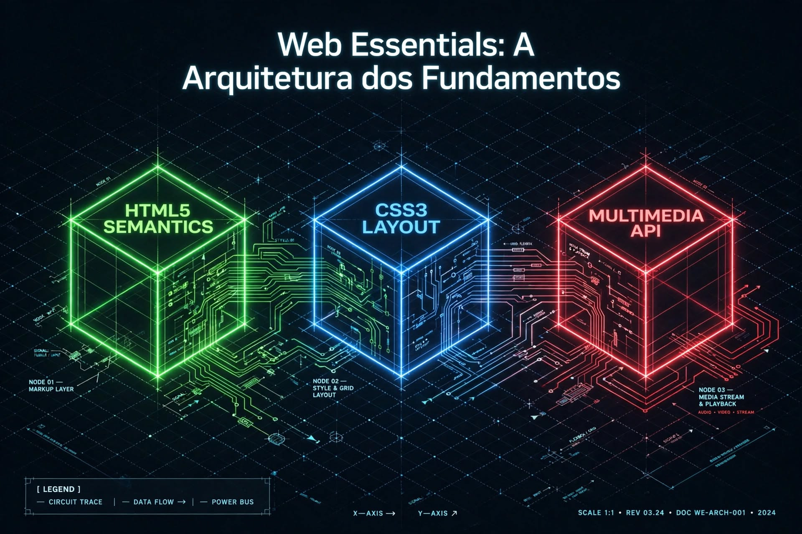
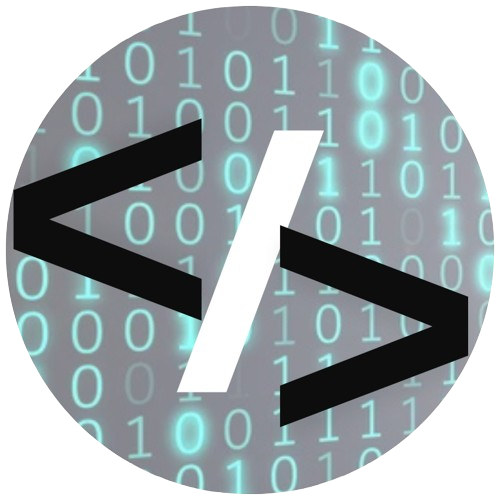

[](https://github.com/Domisnnet/N8n-Workflow-Essentials/blob/main/LICENSE)


<h2 id="sobre-o-projeto">1. N8N Workflow Essentials - Automação com IA 🤖⚙️</h2>

<p align="center">
  
</p>

<p align="center">
  Bem-vindo ao <strong>N8N Workflow Essentials</strong>! Uma coleção de automações low-code que conecta seus projetos Web Essentials (TecBlog, Videos, Domflix, Responsive) com Inteligência Artificial. Inspirado na trilha <strong>Santander - Automação com N8N</strong> da DIO, este projeto transforma commits do GitHub em documentação visual automática via NotebookLM e Gemini.
</p>

---

<h2>📚 Tabela de Conteúdo</h2>

| 🤖 O Projeto | 🛠 Técnico | 🤝 Comunidade |
| :---: | :---: | :---: |
| [](#sobre-o-projeto) | [](#destaques-tecnicos) | [](#codigo-fonte) |
| [](#tecnologias-utilizadas) | [](#instalacao) | [](#creditos) |
| [](#como-acessar) | [](#como-contribuir) | [](#licenca) |
| [](#funcionalidades) | [](#faq) | [](#perfil-do-github) |

---

<h2 id="tecnologias-utilizadas">2.⚙️ Tecnologias Utilizadas</h2>

| Camada | Tecnologias | Descrição |
| :----- | :---------- | :-------- |
| **Automação** |  | Orquestração de workflows low-code rodando em `localhost:5678` |
| **IA Generativa** |   | Análise de código e geração de mapa mental, podcast e infográfico |
| **API** |  | Coleta de commits, descrição e linguagens dos repositórios Web Essentials |
| **Geração Visual** |  | Criação do blueprint isométrico: "Web Essentials - A Arquitetura dos Fundamentos" |

---

<h2 id="como-acessar">3.🚀 Como Acessar</h2>

Este projeto roda localmente. Para testar:


<h4>1. Iniciar o n8n no terminal:</h4>

```bash
npx n8n start
```

<h4>2. Acessar a interface:</h4>

> Abra seu navegador em:

```bash
Acesse http://localhost:5678
```

<h4>3. Importar o workflow:</h4>

Importe o workflow: `workflows/web-essentials.json`

<div align="left">
  <a href="https://n8n.io/" target="_blank">
    
  </a>
</div>


---

<h2 id="funcionalidades">4. 🧩 Funcionalidades Principais</h2>


| Funcionalidade | Descrição |
| :------------- | :-------- |
| 📥 **GitHub Trigger** | Monitora novos commits nos repos TecBlog, Videos, Domflix e Responsive via API                          |
| 🧠 **Prompt Engineering**  | Melhora automaticamente o prompt antes de enviar para Gemini/NotebookLM |
| 🗺️ **Geração Automática**  | Cria Mapa Mental, Guia de Estudos e Infográfico estilo blueprint isométrico |
| 🔗 **Integração** | Conecta NotebookLM -> Google Docs / Notion -> Telegram/WhatsApp |
| 💾 **Versionamento** | Salva workflows em JSON para reuso e portfólio (N8n-Workflow-Essentials) |

---

<h2 id="destaques-tecnicos">5. 💻 Destaques Técnicos</h2>

<h4>📐 Arquitetura do Workflow</h4>

> Uso do padrão `Manual Trigger` → `Set` → `HTTP Request (GitHub API)` → `Code Node` → `AI Node` → `HTTP` para garantir que a automação funcione de forma previsível, tanto offline quanto online.


<h4>🔄 NotebookLM + n8n - RAG</h4>

Implementação do conceito **RAG** - Retrieval-Augmented Generation: o n8n alimenta o NotebookLM com fontes do GitHub, e o NotebookLM gera a documentação visual *"Web Essentials: A Arquitetura dos Fundamentos - Uma dissecação técnica de UI, Semântica e Multimídia por DomisDev"*, com cubos neon (HTML5 verde, CSS3 azul e Multimedia API vermelho).


<h2 id="instalacao">6. 🛠️ Instalação Local</h2>


<h4>1. Clonar o repositório:</h4>

```bash
git clone https://github.com/Domisnnet/N8n-Workflow-Essentials.git
```

<h4>2. Rodar com npx - Recomendado:</h4>

```bash
npx n8n start
```

<h4>Ou rodar com Docker:</h4>

```bash
docker run -it --rm --name n8n -p 5678:5678 -v ~/.n8n:/home/node/.n8n n8nio/n8n
```

> ⚠️ Importante: Após iniciar, vá em Workflows:
>
> Import from File → selecione `workflows/web-essentials-notebooklm.json`
>
> Não esqueça de configurar suas credenciais da API do Google Gemini e GitHub.

---

<h2 id="como-contribuir">7. 🤝 Como Contribuir</h2>

| Fase | Ação | Link / Comando |
| :--: | :--- | :------------- |
| **01** | **Fork**   | [](https://github.com/Domisnnet/N8N-Workflow-Essentials/fork) |
| **02** | **Branch** | `git checkout -b feature/NovoGrafico`            |
| **03** | **Commit** | `git commit -m 'feat: add gráfico de estrelas'`  |
| **04** | **Push**   | `git push origin feature/NovoGrafico`            |
| **05** | **PR**     | [](https://github.com/Domisnnet/N8N-Workflow-Essentials/compare) |

### 🐛 Encontrou um problema?
Se algo não estiver funcionando como esperado, não hesite em abrir um chamado:

[](https://github.com/Domisnnet/N8N-Workflow-Essentials/issues)
[](https://github.com/Domisnnet/N8N-Workflow-Essentials/issues/new)


---

<h2 id="faq">8. 🧠 Perguntas Frequentes</h2>

<details>
<summary><strong>Preciso criar um repositório específico para rodar localmente ❓</strong></summary>
<p>💻 <strong>Resposta:</strong> Não. O n8n salva tudo em <code>~/.n8n</code> localmente. Este repositório serve para versionar seus arquivos JSON, documentar o processo e entregar como projeto de portfólio. <em>Nunca faça commit de credenciais ou arquivos .env com chaves de API.</em>
</details>

<details>
<summary><strong>Posso usar IA dentro do n8n ❓</strong></summary>
<p>🤖 <strong>Resposta:</strong> Sim! Este projeto é a prova. Usamos Google Gemini e NotebookLM dentro do workflow para transformar código em infográficos, podcasts e guias de estudo automaticamente.</p>
</details>

<details>
<summary><strong>Como gerar o infográfico surreal mencionado ❓</strong></summary>
<p>🎨 <strong>Resposta:</strong>  O nó "Code" gera o prompt: <em>"Isometric blueprint technical illustration, dark background with grid, 3 glowing cubes HTML5 SEMANTICS neon green, CSS3 LAYOUT neon blue, MULTIMEDIA API neon red..."</em>. Copie esse prompt e use em ferramentas como Stability AI, DALL-E 3 ou Leonardo.AI.</p>
</details>

---

<h2 id="codigo-fonte">9. 💻 Código Fonte</h2>

Explore a documentação no Repositório Oficial:

[](https://github.com/Domisnnet/N8n-Workflow-Essentials)

---

<h2 id="creditos">10. 📝 Créditos</h2>

| Atribuição | Responsável |
| :--------- | :---------- |
| **Dev & Automação** | **DomisDev** |
| **Inspiração** | **DIO - Santander Automação com N8N & NotebookLM** |
| **IA** | **Google Gemini & NotebookLM** |

---

<h2 id="licenca">11. 📄 Licença</h2>

Este projeto está sob a Licença MIT. Veja o arquivo: &nbsp;[](https://github.com/Domisnnet/N8n-Workflow-Essentials/blob/main/LICENSE) &nbsp; para mais detalhes.

---

<h2 id="perfil-do-github">12. 👨💻 Perfil</h2>

<strong>DomisDev</strong> — Desenvolvedor Web Front-End & Entusiasta de Automação:

<a href="https://github.com/Domisnnet">
  
</a>

&nbsp;
<p align="center">
  <a href="#sobre-o-projeto">
    
  </a>
</p>
