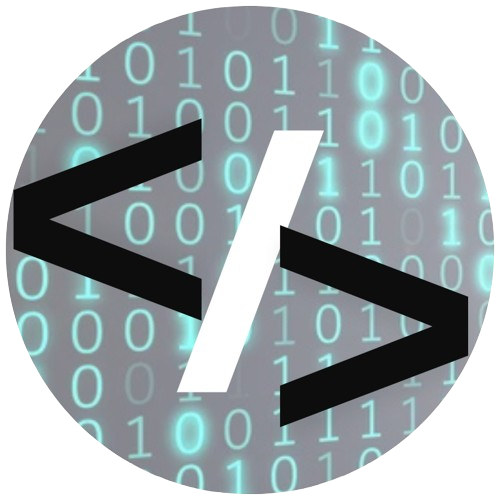

[](https://github.com/Domisnnet/N8n-Workflow-Essentials/blob/main/LICENSE)


<h2 id="sobre-o-projeto">1. 🎯 Sobre o Projeto - Desafio Criativo com n8n:</h2>

<p align="center">
  <strong>Usando Apenas Bons Prompts</strong><br>
  <em>Documentação Oficial da entrega do desafio | Trilha Santander & Automação com n8n:</em>
</p>

> Um bom prompt nasce de intenção clara, contexto e instruções específicas. 
>
> Nesta atividade, organizei minhas ideias e as transformei em comandos claros para orientar uma `IA` a produzir exatamente o `workflow` imaginado para o projeto <strong>n8n Workflow Essentials</strong>.

---

<h2>📚 Tabela de Conteúdo</h2>

| 🤖 O Projeto | 🛠 Técnico | 🤝 Comunidade |
| :---: | :---: | :---: |
| [](#sobre-o-projeto) | [](#destaques-tecnicos) | [](#codigo-fonte) |
| [](#tecnologias-utilizadas) | [](#instalacao) | [](#creditos) |
| [](#como-acessar) | [](#como-contribuir) | [](#licenca) |
| [](#funcionalidades) | [](#faq) | [](#perfil-do-github) |


---

<h2 id="tecnologias-utilizadas">2. ⚙️ Tecnologias Utilizadas  - Defina a Automação:</h2>

<p>Nesta etapa, descrevi qual processo desejo automatizar e quem será beneficiado por ele.</p>

| Campo | Descrição |
| :----- | :---------- |
| **Tarefa repetitiva** | Processar novos commits de repositórios Web Essentials e gerar documentação visual e de estudo automaticamente |
| **Público ou responsável** | Desenvolvedor Full-stack (DomisDev) e comunidade de tecnologia |
| **Resultado esperado** | Transformar código e mensagens de commit em resumos técnicos, mapas mentais e blueprints isométricos, salvando-os de forma organizada |

---

<h2 id="como-acessar">3. 🚀 Commo Acessar - Contexto e Regras:</h2>

<p>Aqui, informei os sistemas envolvidos, as etapas do fluxo e as restrições importantes para garantir a robustez e segurança da automação.</p>

| Categoria | Detalhes |
| :-------- | :------- |
| **Ferramentas** |     |
| **Fluxo desejado** | 1. Receber notificação de novo commit via Webhook ou Polling<br>2. Coletar dados detalhados via HTTP Request (GitHub API)<br>3. Processar e enviar para IA gerar resumo técnico<br>4. Gerar prompt de imagem para Stability AI<br>5. Salvar resultados ou enviar notificação |
| **Regras importantes** | • Ignorar commits de merge ou genéricos<br>• <strong>Nunca</strong> enviar credenciais ou .env para a IA<br>• Em caso de falha, prosseguir salvando apenas texto |

---

<h2 id="funcionalidades">4. 🧩 Funcionalidade - Prompt Final:</h2>

<p>A união de todas as peças em um único prompt completo, pronto para ser executado por uma IA especialista em n8n.</p>

<details>
<summary><strong>📋 Clique aqui para ver/copiar o Prompt Final:</strong></summary>
<br>

```text
Atue como um especialista em n8n e Engenharia de Prompt:

Crie uma automação para processar novos commits de repositórios Web Essentials e gerar documentação visual e de estudo automaticamente.

Público:

Desenvolvedor Full-Stack e comunidade de tecnologia.

Ferramentas envolvidas:

GitHub API - Trigger , n8n , Google Gemini / NotebookLM - IA Generativa e Stability AI - Geração de imagem.

Fluxo:

1. Receber notificação de novo commit no repositório via Webhook ou Polling.
2. Coletar dados detalhados do commit - mensagem, autor, arquivos alterados , via HTTP Request - GitHub API.
3. Processar os dados e enviar para a IA - Gemini/NotebookLM , com engenharia de prompt para gerar um resumo técnico, mapa mental ou roteiro de podcast.
4. Gerar um prompt de imagem baseado na arquitetura e enviar para Stability AI criar um blueprint isométrico.
5. Salvar os resultados no repositório ou enviar notificação formatada - Telegram/Notion.

Regras:
- Ignorar commits de merge ou com mensagens genéricas - ex: "update", "fix", "test".
- Garantir que nenhuma credencial, token ou dado sensível (.env) seja enviado no contexto para a IA.
- Em caso de falha na geração da imagem - Stability AI , prosseguir o fluxo salvando apenas a documentação em texto.

- Explique quais nós do n8n devem ser utilizados e a lógica de funcionamento do workflow.
```
</details>

---

<h2 id="destaques-tecnicos">5. 💻 Destaque Tecnico - Sobre esta Entrega:</h2>

<p>
  Este arquivo <code>desafio-criativo.md</code> foi criado no repositório público <strong>N8n-Workflow-Essentials</strong> para garantir a melhor prática de versionamento e portfólio, conforme as opções recomendadas pela DIO.
</p>

---

<h2 id="instalacao">6. 🛠️ Instalação Local:</h2>

<h4>1. Clonar o repositório:</h4>

```bash
git clone https://github.com/Domisnnet/N8n-Workflow-Essentials.git
cd N8n-Workflow-Essentials
```

<h4>2. Rodar com npx - Recomendado:</h4>

```bash
npx n8n start
```

> ⚠️ Importante: Após iniciar, acesse ```bash http://localhost:5678``` para visualizar e testar os workflows importados.

---

<h2 id="como-contribuir">7. 🤝 Como Contribuir com o Projeto:</h2>

| Fase | Ação | Link / Comando |
| :--: | :--- | :------------- |
| **01** | **Fork**   | [](https://github.com/Domisnnet/N8N-Workflow-Essentials/fork) |
| **02** | **Branch** | `git checkout -b feature/NovoGrafico`            |
| **03** | **Commit** | `git commit -m 'feat: add gráfico de estrelas'`  |
| **04** | **Push**   | `git push origin feature/NovoGrafico`            |
| **05** | **PR**     | [](https://github.com/Domisnnet/N8N-Workflow-Essentials/compare) |

### 🐛 Encontrou um problema?
Se algo não estiver funcionando como esperado, não hesite em abrir um chamado:

[](https://github.com/Domisnnet/N8N-Workflow-Essentials/issues)
[](https://github.com/Domisnnet/N8N-Workflow-Essentials/issues/new)


---

<h2 id="faq">8. 🧠 Perguntas Frequentes:</h2>

<details>
<summary><strong>Por que usar prompts estruturados ❓</strong></summary>
<p>💻 <strong>Resposta:</strong> Prompts com contexto claro, regras específicas e estrutura definida geram resultados muito mais precisos e úteis. A IA entende exatamente o que você precisa.</p>
</details>

<details>
<summary><strong>Posso reutilizar esse prompt para outros workflows? ❓</strong></summary>
<p>🤖 <strong>Resposta:</strong> Sim! A estrutura é modular. Basta adaptar as ferramentas, o fluxo e as regras para o seu caso específico.</p>
</details>

<details>
<summary><strong>Como validar se o prompt está bom? ❓</strong></summary>
<p> <strong>Resposta:</strong> Teste com uma IA - ChatGPT , Gemini ou Claude , e verifique se a resposta inclui: nós corretos do n8n, lógica de funcionamento clara e considerações sobre as regras de segurança.</p>
</details>

---

<h2 id="codigo-fonte">9. 💻 Código Fonte:</h2>

Explore a documentação no Repositório Oficial:

[](https://github.com/Domisnnet/N8n-Workflow-Essentials)

---

<h2 id="creditos">10. 📝 Créditos ao Desenvolvedor:</h2>

| Atribuição | Responsável |
| :--------- | :---------- |
| **Dev & Automação** | **DomisDev** |
| **Inspiração** | **DIO - Santander Automação com N8N & NotebookLM** |
| **IA** | **Google Gemini & NotebookLM** |

---

<h2 id="licenca">11. 📄 Licença:</h2>

Este projeto está sob a Licença MIT. Veja o arquivo: &nbsp;[](https://github.com/Domisnnet/N8n-Workflow-Essentials/blob/main/LICENSE) &nbsp; para mais detalhes.

---

<h2 id="perfil-do-github">12. 👨‍ Perfil:</h2>

<strong>DomisDev</strong> — Desenvolvedor Web Front-End & Entusiasta de Automação:

<a href="https://github.com/Domisnnet">
  
</a>

&nbsp;
<p align="center">
<a href="#sobre-o-projeto">
  
</a>
</p>
